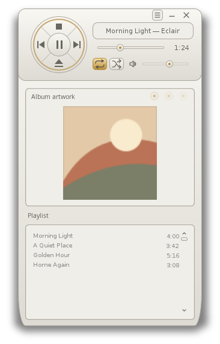
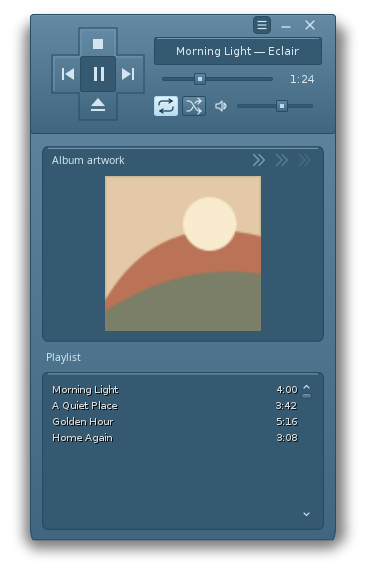
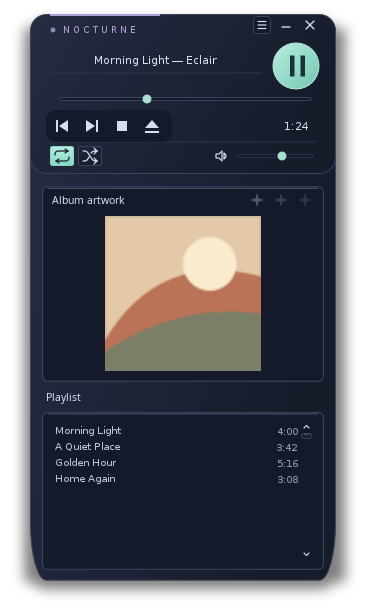
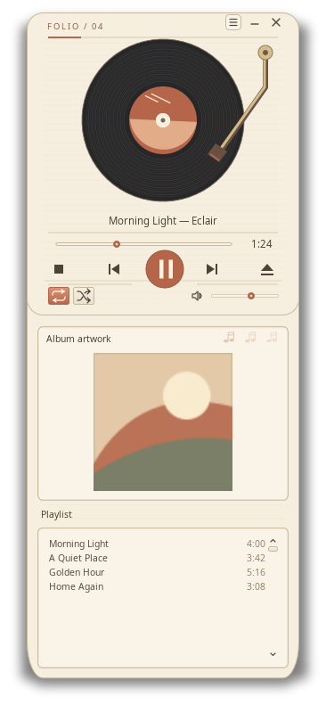
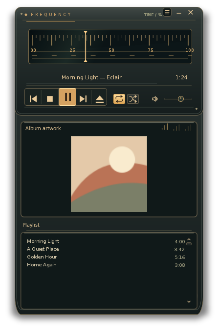
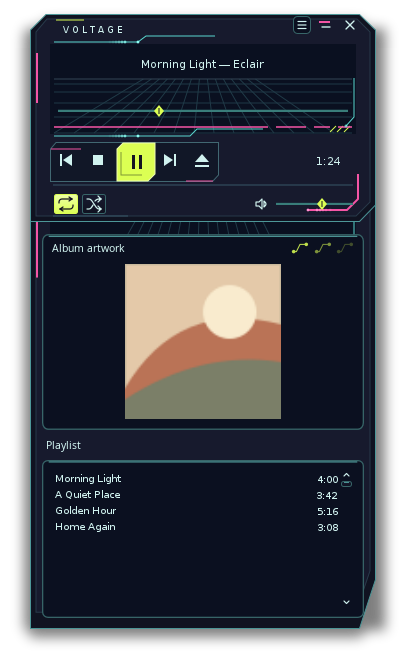
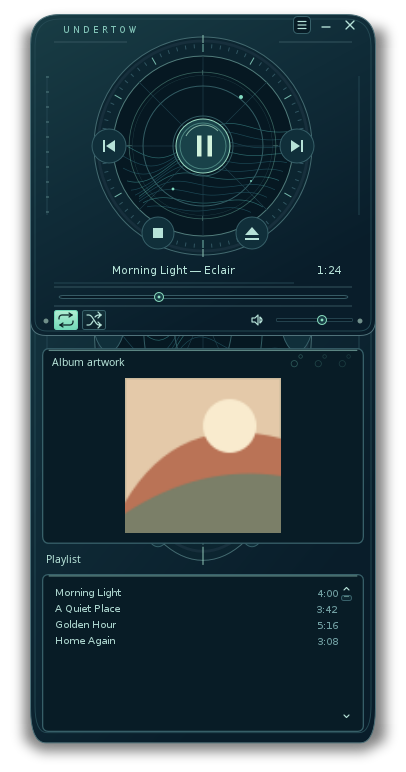

# 🍫 Eclair

A small, skinnable music and video player built with the **Enlightenment Foundation Libraries (EFL)**. A compact desktop companion with album artwork, playlists, and a little old-school character.

## ✨ Features

- Play music and videos, with subtitle support.
- Keep your collection handy with playlists, search, shuffle, and repeat.
- Drag and drop media files or your own album artwork.
- Choose the **Default**, **Gant**, **Nocturne**, **Folio**, **Frequency**, **Voltage**, or **Undertow** theme, with SVG controls and artwork that stay sharp at desktop scale, or load a custom player theme.
- Use a compact themed menu, playlist editor, and About window that follow your desktop scale.

Use the two icon buttons beside the volume control to repeat the whole playlist (loop arrows) or shuffle playback (crossed arrows). Each button stays highlighted while enabled, and both settings are remembered.

Use the burger button in the title bar to open the player menu. A permanent album artwork pane sits between the playback controls and playlist in every theme, inside one fixed player layout. Drop an image onto the artwork to replace the current album cover. Folio also displays album artwork on its record.

New album covers fade gently into their frame. Each theme adds a small animation to the artwork pane during playback. These accents ease back to rest on pause or stop; the panes keep their fixed positions.

- **Default:** warm lights gently brighten and drift.
- **Gant:** blue chevrons glide in a staggered sequence.
- **Nocturne:** lavender stars twinkle beside its breathing playback light.
- **Folio:** warm musical notes sway while the record and tonearm move.
- **Frequency:** amber tuning bars shimmer alongside the position dial.
- **Voltage:** cyan and magenta lights race along the existing circuit lines, turning corners with fading trails for a TRON-inspired glow.
- **Undertow:** sea-glass bubbles rise above the artwork, complementing the sonar echoes.

## 🎨 Theme gallery

Seven different ways to listen. Choose yours from **☰ → Theme**.

<p align="center">
  <strong>Default</strong><br>
  
</p>

<p align="center">
  <strong>Gant</strong><br>
  
</p>

<p align="center">
  <strong>Nocturne</strong><br>
  
</p>

<p align="center">
  <strong>Folio</strong><br>
  
</p>

<p align="center">
  <strong>Frequency</strong><br>
  
</p>

<p align="center">
  <strong>Voltage</strong><br>
  
</p>

<p align="center">
  <strong>Undertow</strong><br>
  
</p>

## 📦 Build & install

You'll need a C compiler, **Meson**, **Ninja**, **pkg-config**, and the development libraries for **EFL**, **json-c**, and **TagLib's C bindings**. EFL should include Elementary, Edje, Eet, Ecore_Con, and Emotion, with a playback backend such as GStreamer and the codecs for your media.

From the project directory:

```sh
meson setup build --prefix=/usr/local
meson compile -C build
sudo meson install -C build
```

This also installs the application-menu launcher and chocolate éclair icon.

If EFL is installed in a custom location, set `PKG_CONFIG_PATH` to its pkg-config directory before running setup.

## ▶️ Enjoy

Open **Eclair** from your application menu, or run:

```sh
eclair
```

To try Folio directly from a build, run `build/src/eclair --theme build/data/themes/folio/folio.edj`.

Try Frequency, Voltage, or Undertow with `build/src/eclair --theme build/data/themes/NAME/NAME.edj`, replacing `NAME` with `frequency`, `voltage`, or `undertow`.

You can also open files directly with `eclair song.ogg` or find more options with `eclair --help`.

Artwork loads from local covers first, then embedded GStreamer metadata. If neither provides an image, Eclair searches Apple’s album catalogue by artist and album and caches a matching cover.

Only one instance can use a configuration directory at a time; a second launch exits silently with a successful status, without changing its files or triggering a desktop launch-failure notice. The lock is released automatically when Eclair exits, including after a crash.

Settings use `eclair.eet`; old XML settings are no longer read. Your theme choice, settings, and saved playlist are kept in `~/.config/eclair`, or `$XDG_CONFIG_HOME/eclair` if configured.

## 👥 Authors

- **Simon Treny (MoOm)** — original lead developer · [simon.treny@free.fr](mailto:simon.treny@free.fr)
- **vko** — original build-system maintainer · [vkoeppel@gmail.com](mailto:vkoeppel@gmail.com)
- **Alastair Poole** — modernisation and maintenance · [netstar@netstar.im](mailto:netstar@netstar.im)

Thanks to everyone who has contributed to Eclair. Original credits are preserved in [AUTHORS](AUTHORS); license details are in [COPYING](COPYING).
